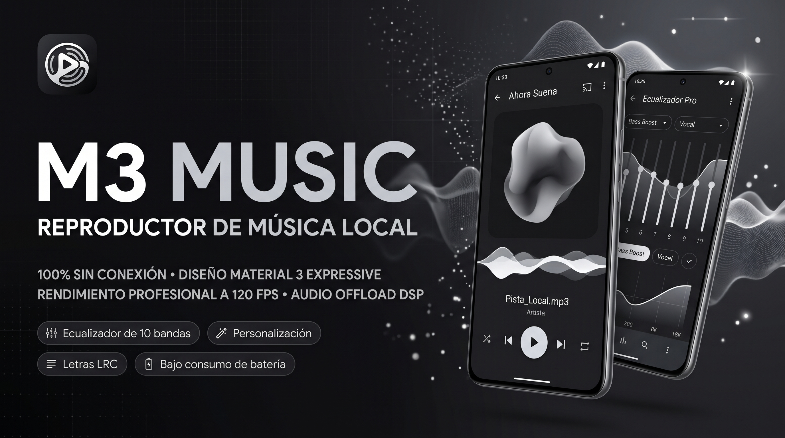
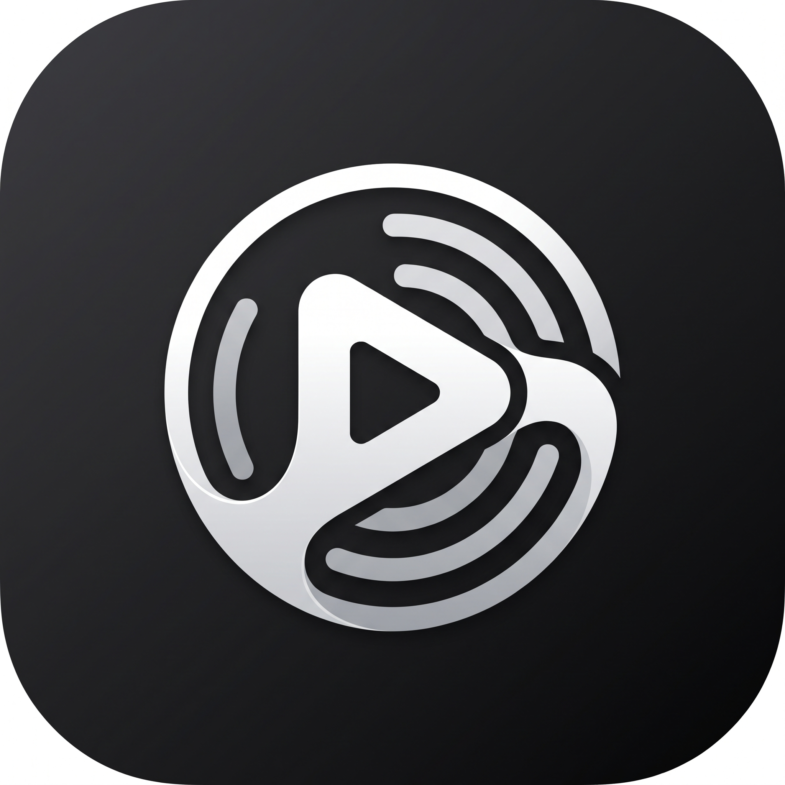
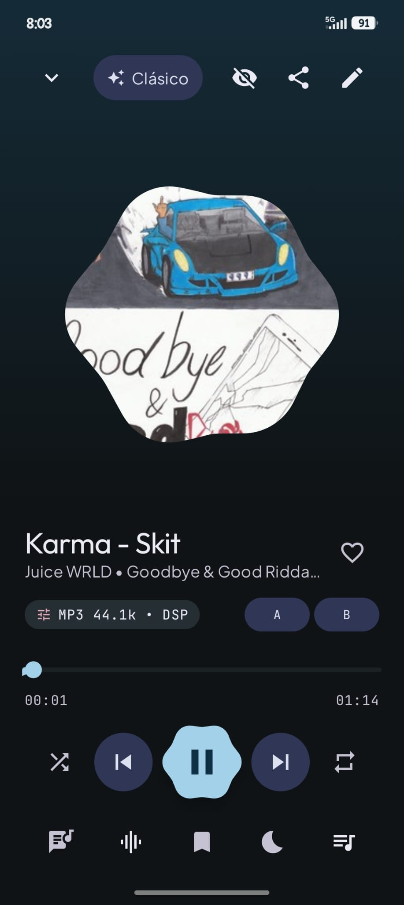
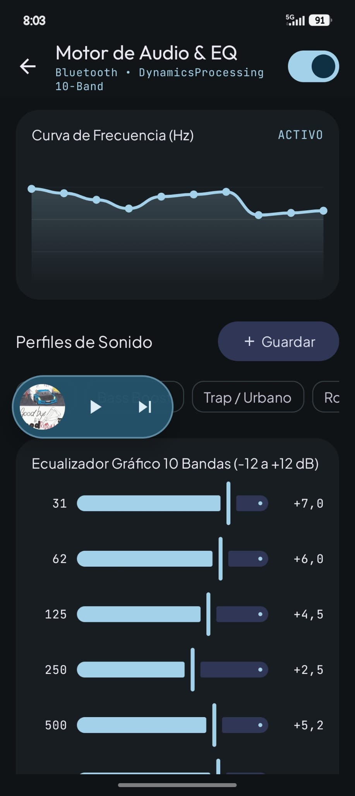
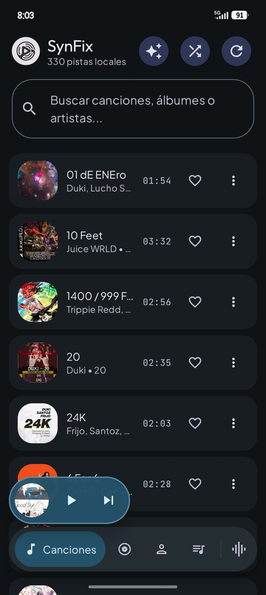
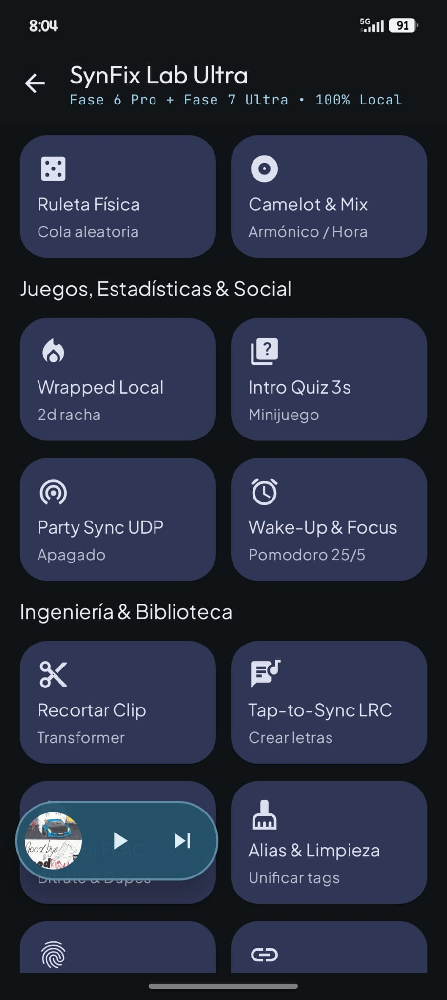

<div align="center">



<br /><br />



# SynFix
### Reproductor de Música Local de Alto Rendimiento • 100% Material Design 3 Expressive

[](https://kotlinlang.org)
[](https://developer.android.com/jetpack/compose)
[](https://developer.android.com/media/media3)
[](#ingeniería-y-optimización-extrema)
[](#)

</div>

---

## Visión General

**M3 Music** es un reproductor de música local (offline) para Android construido desde cero con **Clean Architecture**, **Jetpack Compose** y el lenguaje visual **Material Design 3 Expressive**. 

Diseñado bajo una obsesión absoluta por la eficiencia energética y la fluidez táctil, combina físicas de resorte a **120 FPS constantes**, decodificación de audio delegada al hardware (**DSP Audio Offload**) y más de **40 herramientas exclusivas** de estudio, personalización y gestión quirúrgica de archivos locales.

---

## Galería de Interfaz

| Ahora Suena (Expressive) | Ecualizador & Estudio DSP | Temas & Personalización | Herramientas Pro |
| :---: | :---: | :---: | :---: |
|  |  |  |  |
| *Carátula orgánica reactiva al beat y seekbar ondulada* | *10 bandas, Mid/Side Karaoke y perfiles por dispositivo* | *Barra flotante M3 y modo Negro Puro AMOLED* | *Radar 2D BPM, Looper A-B y Fake-FLAC Auditor* |

---

## Diseño Material 3 Expressive & Personalización

La interfaz está implementada al 100% con componentes nativos de **Compose Material 3 (1.5.0+)** sin librerías UI externas:

* **Físicas de Movimiento (`MotionScheme.expressive()`):** Transiciones gobernadas por resortes espaciales (*Spatial Springs*) con rebote orgánico y resortes de efectos (*Effects Springs*) para cambios cromáticos.
* **Seekbar Ondulada Dinámica (`LinearWavyProgressIndicator`):** La onda fluye al ritmo de la música, modula su amplitud según la energía RMS de la pista y se aplana suavemente al pausar.
* **Morfología de Formas (`MaterialShapes`):** Carátulas y botones (`ButtonGroup`, `SplitButton`) que transforman su geometría reaccionando a los subgraves (20–100 Hz) o al contacto táctil.
* **Navegación Flotante (`HorizontalFloatingToolbar`):** Barra principal flotante con ocultación automática inteligente al hacer scroll.
* **3 Estilos de Pantalla "Ahora Suena":**
  1. **Expressive Clásico:** Carátula con forma orgánica animada y controles táctiles magnéticos.
  2. **Inmersivo Full-Bleed:** Portada de borde a borde con degradado adaptativo extraído de la pista.
  3. **Vinilo & Letras:** Disco giratorio con inercia física real, *scratching* táctil y enfoque en letras sincronizadas.
* **Motor de Temas & Modo Camaleón:** Dynamic Color del sistema, extracción de paleta en vivo desde cada carátula, selector de color semilla personalizado y modo **Negro Puro AMOLED (`#000000`)**.

---

## Motor de Audio & Estudio DSP

Construido sobre **AndroidX Media3 (`ExoPlayer` + `MediaSessionService`)** y **`DynamicsProcessing`**:

* **Ecualizador Gráfico de hasta 10 Bandas:** Curvas suaves en Compose Canvas, Preamplificador (*Preamp*), *Bass Boost*, *Virtualizer* y balance L/R.
* **Perfiles Automáticos por Salida:** Guarda y conmuta automáticamente entre perfiles independientes para **Altavoz**, **Auriculares con cable** y **Bluetooth**.
* **Control Vocal / Karaoke en Vivo (*Mid/Side Stem Control*):** Deslizador en tiempo real que aísla y adelanta las voces (`Mid`) o cancela el canal central para dejar la instrumental (`Side`).
* **Mezcla Continua:** *Gapless Playback* real, *Crossfade* configurable (0–12 s) y *Beat-Matched Crossfade* con ajuste automático de tempo (±4%).
* **Procesamiento Audiófilo:**
  * **True LUFS ReplayGain:** Nivelación automática de sonoridad percibida entre álbumes.
  * **Night Mode DRC:** Compresor multibanda por hardware para escucha nocturna equilibrada.
  * **1-Tap Slowed + Reverb:** Transformación atmosférica en tiempo real sin duplicar archivos.
  * **Smart Dead-Air Trimmer:** Omisión automática de silencios muertos al inicio y final de cada pista.

---

## Funciones Exclusivas (42 Herramientas Pro)

<details>
<summary><strong>1. Interacción Física y UI Viva</strong></summary>

* **Beat-Synced Shape Morphing:** La portada muta entre formas orgánicas M3 al golpe del bombo y subgraves.
* **Botón Play/Pause Magnético:** Atracción hacia el pulgar con micro-háptica sincronizada al resorte.
* **Haptic Vinyl Scratch:** *Scratching* circular sobre la carátula con rozamiento físico e inercia.
* **Sub-Bass Haptic Engine:** Conversión de frecuencias de 20–60 Hz en pulsos hápticos de precisión.
* **Expressive Card Stack Queue:** Cola de reproducción en pila de tarjetas deslizables.
* **M3 Floating Mini-Bubble:** Burbuja flotante con física de colisión contra bordes y anclaje magnético.
* **Liquid Color Drag Transition:** Interpolación cromática proporcional al arrastrar entre canciones.
* **Shared Element Liquid Morphing:** Transiciones fluidas mediante `SharedTransitionLayout`.
</details>

<details>
<summary><strong>2. Herramientas de Estudio y Creatividad</strong></summary>

* **A-B Beat Looper:** Bucle de precisión al milisegundo sobre la onda con control independiente de velocidad y tono.
* **Filtro Rápido de 4 Bandas:** Aislamiento instantáneo de *Sub*, *Kick*, *Vocal* y *Air*.
* **Detector de Tonalidad & Rueda Camelot:** Análisis armónico para mezclar canciones compatibles.
* **Venue & Acoustic Virtualizer:** Simulación física de *Estudio*, *Coche con Subwoofer*, *Club* y *Sala*.
* **Lo-Fi Tape & Vinyl Simulator:** Saturación cálida analógica y textura sutil de vinilo.
* **Volumen Adaptativo al Ruido Ambiente:** Compensación inteligente en calle o gimnasio.
</details>

<details>
<summary><strong>3. Descubrimiento, Rutinas y Gamificación</strong></summary>

* **Radar 2D de Vibe & BPM:** Panel táctil circular (*Chill ↔ Intenso* vs *BPM*) para generar sesiones al instante.
* **Cápsula del Tiempo Sonoro (*Throwback*):** Qué escuchabas hace 1 mes, 6 meses, 1 año o en tu franja horaria actual.
* **Radar de Joyas Olvidadas:** Descubrimiento diario de pistas con cero reproducciones.
* **Quick-Preview Swiper:** Clasificación ultrarrápida saltando directo al segundo 45 de cada canción.
* **Ruleta Física M3:** Selección aleatoria con fricción realista y clics hápticos.
* **Live Local Wrapped:** Estadísticas locales de rachas, minutos y artistas top sin conexión a internet.
* **Intro Quiz de 3 Segundos:** Minijuego local para adivinar tus propios temas en 3 segundos.
* **Local Party Sync:** Sincronización de reproducción sin internet entre dispositivos cercanos.
* **Despertador Progresivo & Pomodoro:** Rutinas sonoras con apertura gradual de volumen y filtro.
</details>

<details>
<summary><strong>4. Utilidades Quirúrgicas para Archivos Locales</strong></summary>

* **Letras Sincronizadas (`.lrc`) & Tap-to-Sync Maker:** Karaoke con salto al tocar cualquier verso y creador integrado de archivos `.lrc` pulsando al ritmo.
* **Editor de Etiquetas (Tag Editor):** Edición directa de metadatos y carátulas en `FLAC`, `MP3`, `M4A`, `OGG`, `WAV` y `OPUS`.
* **Auditor de Duplicados y Fake-FLAC:** Verificación real de espectro y bitrate para detectar archivos lossless reescalados.
* **Recortador Express de Tonos y Clips:** Exportación rápida con *fade-in/out* mediante `Media3 Transformer`.
* **Carátulas Generativas M3:** Arte vectorial determinista en `Canvas` (0 KB en disco) para pistas sin portada.
* **Marcadores de Tiempo en Pistas:** Notas personales ancladas a segundos exactos sobre el seekbar.
* **Cofre Privado Biométrico:** Ocultación de carpetas y canciones tras huella dactilar o PIN.
* **Exportador `.m3u8` con Re-Enlace Inteligente:** Re-vincula listas automáticamente aunque muevas tus carpetas.
* **Modo Bolsillo / Conducción (*Zero-Look*):** Control por gestos ciegos sobre pantalla AMOLED apagada.
* **Real-Time Audio Pipeline HUD:** Inspector en vivo de códec, kHz, profundidad de bits y estado de *Hardware Offload*.
* **Tarjetas de Sesión Compartibles:** Exportación instantánea de fichas visuales M3 con onda y badge técnico.
</details>

---

## Ingeniería y Optimización Extrema

Cada subsistema está diseñado para eliminar cuellos de botella de CPU, RAM y batería:

1. **Hardware Audio Offload (DSP):** Cuando el ecualizador está desactivado o en bypass, `ExoPlayer` delega la decodificación directamente al chip DSP del SoC, permitiendo que la CPU entre en sueño profundo con la pantalla apagada.
2. **Baseline Profiles + R8 Full Mode:** Precompilación AOT de rutas críticas de arranque y scroll para garantizar **120 FPS desde el primer frame**.
3. **Cero Recomposiciones Innecesarias:**
   * Compilador de Compose con *Strong Skipping* y modelos estrictamente `@Immutable` (`ImmutableList`).
   * Animaciones continuas, gestos y rotaciones ejecutadas en fase de dibujo mediante `Modifier.graphicsLayer { ... }` y lecturas de estado diferido.
4. **Gestión Quirúrgica de Memoria (Coil 3):**
   * Caché en disco desactivada para URIs locales de `MediaStore` (evita duplicar almacenamiento).
   * *Downsampling* exacto al tamaño del componente, *Hardware Bitmaps* y caché LRU limitada al 15% de la heap.
   * Paletas de color calculadas sobre miniaturas de `64x64 px` en `Dispatchers.Default` y cacheadas por `albumId`.
5. **SQLite / Room de Alto Rendimiento:** Modo `WAL` (*Write-Ahead Logging*), índices compuestos y proyecciones ligeras para listar **+15.000 canciones** sin latencia.

---

## Stack Tecnológico

| Capa | Tecnología |
| :--- | :--- |
| **Lenguaje** | Kotlin 2.x (Coroutines & Flow) |
| **Interfaz de Usuario** | Jetpack Compose + Material 3 Expressive (`1.5.0+`) |
| **Motor Multimedia** | AndroidX Media3 (`ExoPlayer`, `MediaSessionService`, `Transformer`) |
| **Procesamiento Audio** | `DynamicsProcessing`, `EnvironmentalReverb`, `LoudnessEnhancer`, `AudioProcessor` |
| **Arquitectura & DI** | Clean Architecture + MVI/MVVM Unidireccional + Dagger Hilt |
| **Persistencia** | Room Database (WAL) + Jetpack DataStore Preferences |
| **Carga de Imágenes** | Coil 3 + AndroidX Palette |
| **Tareas en Segundo Plano** | WorkManager (escaneo LUFS / BPM solo durante carga) |

---

## Instalación y Compilación

```bash
# 1. Clonar el repositorio
git clone [https://github.com/tu-usuario/m3-music.git](https://github.com/tu-usuario/m3-music.git)
cd m3-music

# 2. Compilar versión Release optimizada con R8 Full Mode y Baseline Profiles
./gradlew assembleRelease
```

---

## Licencia

Distribuido bajo la licencia **MIT**. Consulta el archivo `LICENSE` para más información.
